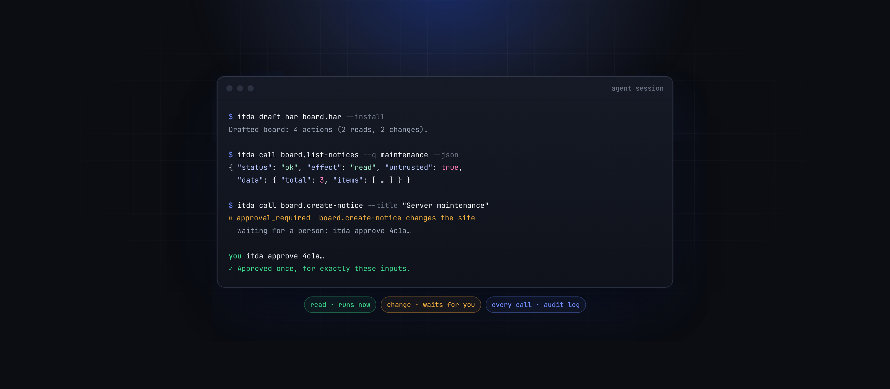
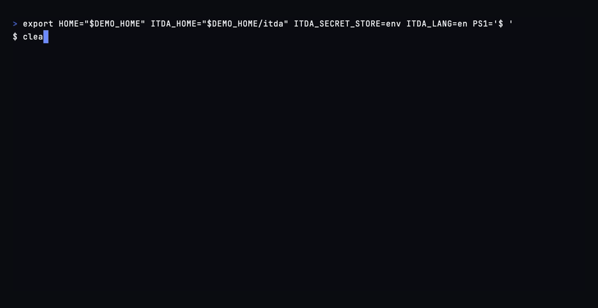

<p align="center"></p>

<p align="center"><strong>Tapez une adresse après itda et votre IA peut utiliser le site.</strong></p>

<p align="center"><a href="README.md">English</a> | <a href="README.ko.md">한국어</a> | <a href="README.ja.md">日本語</a> | <a href="README.zh-Hans.md">简体中文</a> | <a href="README.zh-Hant.md">繁體中文</a> | <a href="README.es.md">Español</a> | <b>Français</b> | <a href="README.de.md">Deutsch</a> | <a href="README.pt-BR.md">Português (Brasil)</a> | <a href="README.vi.md">Tiếng Việt</a> | <a href="README.id.md">Bahasa Indonesia</a> | <a href="README.ru.md">Русский</a></p>

<p align="center">
  <a href="https://github.com/brnyxx/itda-cli/actions/workflows/ci.yml"></a>
  <a href="https://github.com/brnyxx/itda-cli/releases"></a>
  <a href="LICENSE"></a>
  <a href="https://brnyxx.github.io/itda-cli/docs/">Docs</a>
</p>

Donnez une adresse à itda. Il apprend ce que le site sait faire et l'essaie. Il
donne à votre agent IA une courte liste d'actions en mots simples. Les lectures
marchent tout de suite. Rien ne change sur le site tant que vous ne dites pas
oui. Il tourne sur votre propre ordinateur, et il marche aussi sur le vieil
intranet derrière une connexion.

Il est fait pour les sites de votre entreprise et les services où vous avez un
compte, pas pour tout le web.

<p align="center"></p>

<details>
<summary>La même exécution en texte</summary>

```console
$ itda news.ycombinator.com
1/5  Examen de news.ycombinator.com...
    La page s'ouvre sans connexion.
    Trouvé : une liste de 30 enregistrements, un formulaire, un flux.
2/5  Ce que les agents pourront faire :
    lecture home         List what Hacker News shows  (entrées : p)
    lecture feed         Read the RSS feed
3/5  Essai de chaque lecture une fois...
    ✓ home         30 enregistrements
    ✓ feed         ok
4/5  Enregistré sous 'news-ycombinator'.
    Connecter Claude Desktop ? [Y/n]
5/5  Ajout d'itda à Claude Desktop...
itda ajouté à Claude Desktop (~/Library/Application Support/Claude/claude_desktop_config.json).
Ouvrez Claude Desktop et itda sera là.

Terminé. Demandez quelque chose à votre agent sur 'news-ycombinator', par exemple "utilise news-ycombinator pour List what Hacker News shows".
```

</details>

Demandez à votre agent : *« utilise news-ycombinator pour lister ce que montre
Hacker News »*. Un site derrière un formulaire de connexion demande à la place
votre nom d'utilisateur et votre mot de passe. itda remplit le formulaire du
site en son propre nom et garde la session sur votre ordinateur. Si cela ne
suffit pas (authentification unique, code à usage unique), votre propre
navigateur s'ouvre. Vous vous connectez et utilisez le site comme d'habitude
pendant qu'itda regarde.

<p align="center"></p>

> Statut : jeune, et utilisé sur de vrais sites. Le moteur d'exécution, la CLI,
> le serveur MCP, les approbations (dans un terminal ou dans l'application de
> l'agent), le journal d'audit, le brouillon à partir de documents OpenAPI,
> d'enregistrements de navigateur ou de pages récupérées, les clés d'API, la
> connexion par navigateur et les étapes préalables CSRF marchent aujourd'hui.
> Les paquets de sites signés viennent ensuite. Voir
> [docs/ARCHITECTURE.md](docs/ARCHITECTURE.md).

## Pourquoi

Les agents qui pilotent un navigateur relisent chaque page et dépensent des
milliers de jetons à chaque capture d'écran ou instantané d'accessibilité. Ils
cliquent sur ce que la page leur dit de cliquer et cassent en silence quand une
mise en page change. itda déplace ce travail vers une étape d'installation :

| | Agent qui pilote un navigateur | itda |
|---|---|---|
| Ce que voit l'agent | Des pages entières, à chaque étape | Le résultat typé d'une action, plafonné à 24 Ko |
| Une page changée ou déconnectée | Lue comme des données | Détectée à partir de la réponse déclarée (`response_mismatch`, `auth_required`) |
| Modifications sur le site | Ce que le modèle décide | Approbation à usage unique pour des entrées exactes, donnée par une personne dans un terminal ou l'application de l'agent |
| Un texte sur la page disant « ignore les instructions précédentes » | Dans le prompt | Marqué données non fiables, jamais un outil |
| Identifiants | Tapés dans la page par le modèle | Dans le trousseau du système ; l'agent ne voit que des identifiants de compte |
| Être bloqué | Réessayer, changer d'IP, imiter un navigateur | S'arrêter, vous prévenir, attendre que vous repreniez |
| Ce qui s'est passé | Historique de conversation | Journal d'audit à chaîne de hachage que vous pouvez vérifier |

## Ce qui marche et ce qui ne marche pas

Chaque ligne ici est vraie du code d'aujourd'hui. `itda setup` dit quel cas il
a rencontré ; `itda draft page` ou `itda record` disent ce qu'ils ont laissé de
côté.

**Marche aujourd'hui**

- Pages rendues côté serveur : tableaux, listes et cartes répétées deviennent
  des enregistrements, et une page qui est une seule chose devient une lecture
  de ses champs. Les formulaires de recherche deviennent des lectures, les
  formulaires d'envoi deviennent des modifications, et les flux suivent.
- Pages qui intègrent leurs données pour leurs scripts (`__NEXT_DATA__`,
  `ld+json`, un état Apollo ou préchargé) : une lecture par liste.
- Pages dessinées par des scripts qui appellent une API répondant en JSON, un
  portail React ou Vue par exemple : `itda setup` ouvre votre navigateur sur la
  page et regarde ce qu'elle charge d'elle-même. Il fait un brouillon à partir
  de ces appels. Il ne clique ni ne tape.
- Formulaires qui veulent un jeton CSRF : une étape préalable en lit un frais
  sur la page du formulaire juste avant chaque envoi approuvé.
- Pages qui sont une coquille autour de cadres : le contenu est dans un
  `<iframe>` du même site, souvent derrière sa propre connexion. itda lit chaque
  cadre comme une page du site et se connecte d'abord quand le cadre le demande.
- Sessions par cookie : une connexion par le formulaire du site avec votre nom
  d'utilisateur et votre mot de passe, ou votre propre navigateur pour
  l'authentification unique et les codes à usage unique. Une session portée
  dans l'adresse (`?sid=...`) marche de la même façon.
- Une description OpenAPI ou Swagger publiée par le site, et un point d'accès
  GraphQL qui répond à l'introspection : une lecture par opération ou champ de
  requête.
- Sites qui tournent sous GitLab, Jira, Confluence, Redmine, Discourse,
  MediaWiki, WordPress, Gitea ou Forgejo : leur propre API, à partir d'un modèle
  tout prêt.
- Tout ce que vous avez enregistré en l'utilisant vous-même, dans votre
  navigateur ou sous forme de fichier HAR.

**Marche après enregistrement**

- Une page qui ne montre rien à une simple récupération et ne charge rien
  d'elle-même. Elle ne récupère quelque chose qu'après un clic, une recherche
  ou une connexion. `itda record` vous regarde l'utiliser et fait un brouillon à
  partir des appels qu'il a vus.

**Ne marche pas**

- WebSocket. itda parle HTTP simple, et un enregistrement ne garde aucun trafic
  de socket.
- Les API qui signent chaque requête (une signature ou un nonce calculé par
  appel). itda garde un jeton ou une clé d'API fixe dans le trousseau. Il ne
  reproduit pas une valeur qui change à chaque appel, donc le site refuse la
  requête.
- Les pages assemblées à partir de fragments HTML (htmx et autres). Pas par
  principe : itda peut encore lire un fragment qui contient un tableau entier,
  mais pas ce que le script en fait.
- Le contenu dessiné sur un canvas ou dans une image. itda lit du texte en HTML,
  JSON et XML ; il ne regarde pas les pixels.
- Les sites derrière un défi ou un gestionnaire de bots (Cloudflare, Akamai, un
  captcha). itda dit qui il est et n'imite jamais un navigateur. Il met le site
  en pause jusqu'à ce que vous le repreniez. Voir
  [docs/HONEST_CLIENT.md](docs/HONEST_CLIENT.md).
- Tout ce que votre compte ne peut pas voir. itda n'a pas de compte à lui ; il
  utilise le vôtre.

## Quand le site change

`itda check <site>` lance chaque lecture qui n'a besoin d'aucune entrée et
n'envoie jamais de modification. Il finit sur un seul verdict : `ok`,
`signed_out`, `site_changed`, `blocked` ou `unreachable`. Le code de sortie le
suit (11 pour `site_changed`), donc une tâche planifiée peut vous prévenir avant
qu'un agent ne tombe dessus. Via MCP, `itda_check` renvoie la même chose.

Quand le verdict est `site_changed`, `itda refresh <site>` refait le brouillon
du site à partir de ce qui a servi à le configurer : ses pages, la description
de l'API, le point d'accès GraphQL, ou la forme conservée de l'enregistrement,
chaque valeur effacée. Il montre ce qui changerait par action et n'écrit rien
tant que vous ne dites pas oui. itda garde les actions que vous avez modifiées à
la main et met à jour celles que le nouveau brouillon a changées. Il ne retire
une action que les sources ne produisent plus que si sa lecture a aussi échoué,
et essaie chaque nouvelle action une fois, en l'ajoutant si elle répond. itda
retire les approbations en attente pour le site et vérifie le site à nouveau
juste après. Une définition installée avec `itda add` n'a pas de sources et ne
peut pas être rafraîchie ; modifiez-la à la main.

C'est le compromis. Un agent de navigateur s'adapte à chaque exécution, et il
est lent et non déterministe pour cela. itda, c'est une requête et la même
réponse à chaque fois. Il casse bruyamment quand le site bouge.

## À côté des agents de navigateur

Playwright MCP, browser-use et computer use pilotent un navigateur à chaque
tâche. itda ne les remplace pas : une page que vous utiliserez une fois, ou un
site de la liste ci-dessus qu'itda ne couvre pas, c'est pour eux. itda est fait
pour le site qu'un agent appellera encore et encore. Enregistrez-le une fois
dans un navigateur, relisez les actions, puis lancez-les en HTTP avec une
réponse typée, une approbation à usage unique pour chaque modification et un
journal. Utilisez les deux : un agent de navigateur pour explorer, itda pour les
appels qui tournent tous les jours.

## Démarrage rapide

```sh
# macOS et Linux
curl --proto '=https' --tlsv1.2 -LsSf https://github.com/brnyxx/itda-cli/releases/latest/download/itda-cli-installer.sh | sh
```

```powershell
# Windows
powershell -ExecutionPolicy Bypass -c "irm https://github.com/brnyxx/itda-cli/releases/latest/download/itda-cli-installer.ps1 | iex"
```

Téléchargez une archive depuis les
[Releases](https://github.com/brnyxx/itda-cli/releases), ou compilez depuis les
sources avec `cargo install --git https://github.com/brnyxx/itda-cli itda-cli`.

Claude Desktop, sans terminal : téléchargez le paquet pour
[macOS (Apple silicon)](https://github.com/brnyxx/itda-cli/releases/latest/download/itda-aarch64-apple-darwin.mcpb),
[macOS (Intel)](https://github.com/brnyxx/itda-cli/releases/latest/download/itda-x86_64-apple-darwin.mcpb) ou
[Windows](https://github.com/brnyxx/itda-cli/releases/latest/download/itda-x86_64-pc-windows-msvc.mcpb) et ouvrez le fichier.
Claude Desktop installe itda avec ses outils, et « utilise
the-site-you-use.example » configure un site depuis la conversation.
Approuver une modification se fait toujours dans un terminal avec
`itda approve`, donc pour les modifications installez aussi la commande.

Tapez `itda` et l'adresse d'un site que vous utilisez. Il trouve les
applications d'agent sur votre ordinateur et les connecte après un seul Entrée.
Il parle douze langues : `LANG` en choisit une et `ITDA_LANG` l'emporte. Un simple `itda` demande l'adresse ;
`itda setup <adresse>` prend des options pour les scripts.

itda reconnaît les sites qui tournent sous un logiciel connu. Quand la page dit
qu'elle est un GitLab, Jira, Confluence, Redmine, Discourse, MediaWiki,
WordPress ou Gitea (aussi Forgejo), et qu'une requête à l'API de ce logiciel le
confirme, l'agent reçoit la vraie API de ce logiciel à partir d'un modèle tout
prêt ([`sites/software/`](sites/software/)), connecté comme ce logiciel le fait.
Ce que la page elle-même montre s'y ajoute. `itda setup --as jira` force un
modèle ; `--no-template` lit la page comme n'importe quelle autre.

Une page dessinée par des scripts ne montre à itda qu'un titre, alors itda ouvre
votre navigateur dessus pendant quelques secondes. Il regarde ce que la page
charge d'elle-même et fait un brouillon à partir de ces appels. Rien n'est
cliqué ni tapé, et la fenêtre se ferme seule. Seule une page qui ne montre
toujours rien, ou qui demande une connexion, vous demande d'utiliser le site
dans votre navigateur pendant qu'itda regarde.

Une fois un agent connecté, vous pouvez aussi simplement lui demander :
« configure news.ycombinator.com pour moi ». Il appelle `itda_setup`. itda
regarde le site, fait le brouillon et l'essaie de la même façon. Ses actions
apparaissent comme des outils dans la même conversation. Une page scriptée
s'ouvre brièvement dans une fenêtre de navigateur sur votre écran. Quand une
lecture demande de se connecter, `itda_login` ouvre votre propre navigateur ;
l'agent ne voit que l'identifiant du compte.

Passez-vous du terminal et donnez ceci à Claude Code, Cursor ou Codex, avec
l'adresse d'un site que vous utilisez :

```text
Installe itda et configure the-site-you-use.example pour moi.
1. Installe-le : curl -LsSf https://github.com/brnyxx/itda-cli/releases/latest/download/itda-cli-installer.sh | sh
   (sous Windows : irm https://github.com/brnyxx/itda-cli/releases/latest/download/itda-cli-installer.ps1 | iex)
2. Lance : itda setup https://the-site-you-use.example --client claude-code -y
   (mets cursor, codex ou claude-desktop si c'est ce que tu es)
3. Lis https://github.com/brnyxx/itda-cli/blob/main/AGENTS.md, puis utilise le site via itda.
   Les lectures marchent directement. Tout ce qui modifie le site attend mon approbation.
   Si une lecture demande de se connecter, dis-moi de lancer : itda login <site> --browser
```

Les morceaux sont des commandes à part entière. Pour les pages que vous pouvez
ouvrir sans vous connecter, donnez leurs adresses à itda. Tableaux, listes et
cartes répétées deviennent des enregistrements. Une page qui est une seule
chose (un paquet, un article, un produit) devient une lecture de son titre, de
son corps et de ses valeurs étiquetées. Une liste dont les liens partagent une
même forme reçoit une lecture d'un enregistrement par son identifiant. Les
formulaires de recherche deviennent des lectures ; les formulaires d'envoi
deviennent des modifications. Les flux suivent. Un point d'accès GraphQL nommé
par la page est interrogé une fois sur ce qu'il propose, une lecture par champ
de requête. Quand le site publie une description d'API, ses lectures rejoignent
le brouillon :

```sh
itda draft page https://example.com/board --install   # montre ce qu'il a trouvé sur la page
itda call example.get-board --page 2 --json
itda check example                                     # la page correspond-elle toujours ?
```

Pour un site derrière un formulaire de connexion, donnez la page et votre nom
d'utilisateur à `itda setup`. Il envoie le formulaire du site une fois, en son
propre nom, avec le mot de passe que vous tapez. Il garde la session dans le
trousseau du système et fait le brouillon à partir de la page telle que vous la
voyez connecté. La définition se souvient du formulaire, donc `itda login board`
se reconnecte quand la session expire :

```sh
itda setup https://intranet.example/board --name board --user me   # demande le mot de passe
itda call board.list-notices --json                 # les lectures se font tout de suite
itda call board.create-notice --title "Server maintenance"   # les modifications attendent votre approbation
itda login board --user me                          # quand la session expire
```

Pour l'authentification unique ou un code à usage unique, enregistrez-vous
plutôt en train d'utiliser le site. itda ouvre votre propre navigateur dans une
nouvelle fenêtre. Il regarde ce que les pages demandent au serveur pendant que
vous vous connectez, cherchez et envoyez un formulaire ; il ne clique ni ne
tape jamais :

```sh
itda record https://intranet.example/board --name board --install   # appuyez sur Entrée quand c'est fini
                                                    # puis dites oui pour garder la session ou le jeton utilisé
itda mcp install claude-desktop                     # ou laissez votre agent les appeler
```

`examples/lab` fait tourner Gitea, Redmine, WordPress, MediaWiki, un petit
intranet ancien et trois cas plus laids derrière leurs connexions : un forum
dans un iframe, un tableau qu'un script dessine à partir d'un XHR, et une
session portée dans l'URL. Une suite de tests parcourt chacun de la
configuration à une modification approuvée.

L'enregistrement reste en mémoire et seule la forme de chaque appel arrive au
brouillon : aucun en-tête, cookie ou valeur que vous avez tapée. Un fichier HAR
enregistré depuis les outils de développement du navigateur marche de la même
façon avec `itda draft har`.

Les API publiques n'ont pas besoin d'enregistrement. Ces sites tout prêts de
[sites/](sites/README.md) sont intégrés et n'ont pas besoin de compte :

<p><a href="sites/github.yaml"></a> <a href="sites/npm.yaml"></a> <a href="sites/crates-io.yaml"></a> <a href="sites/pypi.yaml"></a></p>

```sh
itda add github      # ou npm, crates-io, pypi
itda call github.repo --owner rust-lang --repo rust
```

Essayez le bac à sable fourni, un faux intranet qui n'écoute que sur
127.0.0.1 : suivez [examples/sandbox](examples/sandbox/README.md). Une
définition de site est un seul fichier YAML. `itda add spec.yaml` l'installe
après avoir montré où elle envoie des requêtes et quelles actions modifient le
site. `itda doctor` affiche l'emplacement du répertoire de données.
[docs/SPEC.md](docs/SPEC.md) explique comment écrire une définition.

```sh
itda setup <url>                         # page ou enregistrement -> actions nommées -> essayées -> agent, avec des questions
itda draft page <url>... [--install]     # brouillon d'un site à partir des pages que vous utilisez
itda record <url> [--install]            # ou en l'utilisant dans votre navigateur, derrière une connexion
itda draft har <file> / openapi <file>   # ou à partir d'un enregistrement sauvegardé ou d'une description d'API
itda add spec.yaml / remove <site>       # installer ou retirer un site (aussi une URL ou github)
itda ls                                  # sites installés et leurs actions
itda describe <site>                     # leurs entrées et une commande à copier pour chacune
itda call <site>.<action> --input value  # en lancer une ; --json pour les agents
itda login <site> --user me              # se connecter par le formulaire du site (mot de passe via stdin ou une question)
echo "$KEY" | itda login <site> --secret api-key   # ou stocker une clé d'API dans le trousseau du système
itda login <site> --browser              # ou se connecter dans votre propre navigateur, une fois (scellé dans le répertoire de données)
itda accounts / logout <site>            # voir ou retirer les connexions enregistrées
itda approvals / approve <id> / reject <id>
itda audit [--verify]                    # ce que les agents ont fait
itda check [<site>|--all]                # chaque lecture correspond-elle toujours au site ?
itda refresh <site>                      # un site a changé : refaire le brouillon, garder ce que vous avez décidé
itda resume <site>                       # après qu'un site a refusé ou qu'une clé a expiré
itda feedback                            # signaler un problème : ouvre un nouveau ticket, prérempli
```

## L'utiliser depuis un agent

```sh
itda mcp install claude-desktop   # ou cursor, vscode, codex
itda mcp install claude-code      # affiche la commande `claude mcp add`
# ajoutez --approve-in-client pour approuver les modifications dans le formulaire du client
# itda mcp --site <name> ne sert qu'un site, pour la configuration propre à un projet
```

L'installateur fusionne dans la configuration du client et garde vos autres
serveurs. Il sauvegarde l'ancien fichier en `.bak`. `--dry-run` montre d'abord
la modification. `itda mcp` sert chaque site installé :

- Jusqu'à 30 actions apparaissent chacune comme un outil
  (`sandbox.list-notices`), avec des schémas d'entrée et des indications
  lecture seule, destructif et idempotent.
- Au-delà, trois outils stables (`itda_search`, `itda_describe`, `itda_call`)
  gardent la liste d'outils courte et les caches de prompt valides. `--mode`
  remplace ce comportement.
- Les résultats sont la même enveloppe JSON que `itda call --json`, marquée
  non fiable.
- Une modification renvoie `approval_required` avec un identifiant. Aucun
  outil n'approuve ; l'agent doit vous demander.

Les agents qui n'ont qu'un shell peuvent appeler `itda call … --json` et
brancher sur le code de sortie :

| Sortie | Sens |
|---|---|
| 0 | ok |
| 2 | mauvaise entrée ou action inconnue |
| 10 | se reconnecter (`itda login`) |
| 11 | la page ne correspond plus à sa définition |
| 12 | le site a refusé ; en pause jusqu'à `itda resume` |
| 13 | fréquence limitée |
| 14 | le site a refusé cette requête comme non autorisée ; se reconnecter n'aidera pas |
| 20 | approbation nécessaire, ou l'utilisateur n'a pas encore répondu (ou les modifications sont désactivées) |
| 21 | approbation utilisée, rejetée, expirée ou retirée parce que les entrées ont changé |
| 22 | itda a envoyé une modification mais son résultat est inconnu ; vérifiez le site |
| 30 | erreur réseau |

## Principes

- **Local d'abord.** Les définitions tournent sur votre appareil. Les
  identifiants ne le quittent jamais.
- **Lecture seule par défaut.** Une action n'est une lecture que lorsque sa
  méthode, son nom, son chemin, ses entrées et son document GraphQL sont tous
  d'accord. Tout le reste est une modification.
- **Les personnes approuvent les modifications.** Chaque approbation couvre une
  requête avec des entrées, un compte, une définition et un identifiant exacts.
  Elle marche une fois et expire.
- **Les blocages sont signalés, pas contournés.** itda dit qui il est et
  n'imite jamais un navigateur. Il met en pause un site qui le refuse. Voir
  [docs/HONEST_CLIENT.md](docs/HONEST_CLIENT.md).
- **Actions vérifiées.** Une définition déclare à quoi ressemble une réponse
  correcte, donc « déconnecté » et « le site a changé » sont des erreurs, pas
  des données.

## Organisation

Les crates ne dépendent que des crates en dessous d'elles ;
`cargo xtask check-layers` le vérifie.

| Couche | Crate | Rôle |
|---|---|---|
| 0 | `itda-types` | Contrat d'erreur, vérifications d'URL (Public Suffix List), caviardage |
| 1 | `itda-html`, `itda-store` | Extraction HTML sans script ; le magasin SQLite local |
| 2 | `itda-spec` | Format de définition, construction des requêtes, vérification des réponses |
| 3 | `itda-policy` | Classification lecture/écriture, contrôles de sûreté des définitions, approbations |
| 4 | `itda-net` | HTTP borné, cadence, détection de blocage, garde contre les adresses privées |
| 5 | `itda-vault` | Comptes et secrets dans le trousseau du système ou l'environnement |
| 7 | `itda-runtime` | Exécute les actions : identifiants, approbations, mise en forme, journal d'audit |
| 9 | `itda-setup` | Les étapes de configuration, de connexion et de vérification, pour la CLI et le serveur MCP |
| 10 | `itda-mcp` | Serveur MCP sur stdio |
| 11 | `apps/cli` | La commande `itda` |

## Développer

```sh
cargo test --workspace --locked
cargo clippy --workspace --all-targets --locked -- -D warnings
cargo xtask check-layers
```

`rust-toolchain.toml` fixe Rust 1.98 (édition 2024). Les tests ne parlent qu'à
des serveurs locaux qu'ils démarrent eux-mêmes. Les règles de commit et de
pull request sont dans [CONTRIBUTING.md](CONTRIBUTING.md).

## Sécurité

[docs/THREAT_MODEL.md](docs/THREAT_MODEL.md) liste ce contre quoi itda se
défend et ce contre quoi il ne se défend pas. Signalez les vulnérabilités comme
décrit dans [SECURITY.md](SECURITY.md).

## Crédits et licence

Sous licence [Apache-2.0](LICENSE). Des parties de ce projet dérivent de
[Hycli](https://github.com/Hybirdss/Hycli) (Apache-2.0) ; voir [NOTICE](NOTICE).
Chaque fichier dérivé le dit dans son en-tête et décrit ce qui a changé. Ce
projet n'est pas affilié à Hycli et n'utilise ni son nom ni ses marques.
