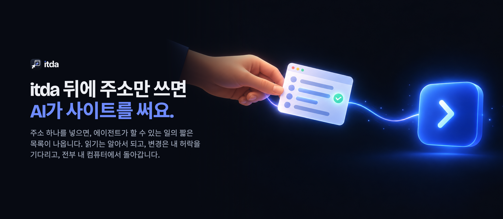
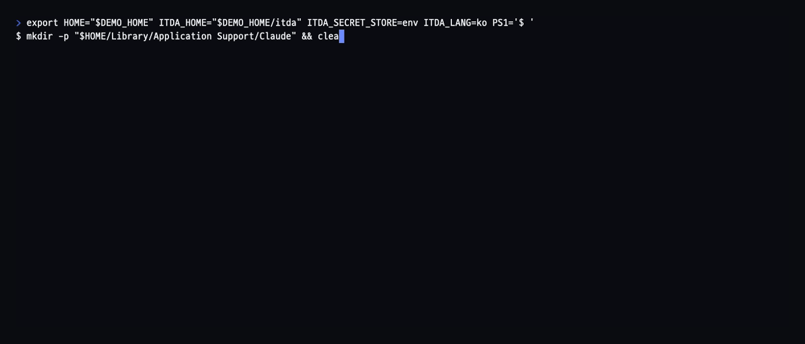

<p align="center"></p>

<p align="center"><strong>itda 뒤에 주소만 쓰면 AI가 사이트를 써요.</strong></p>

<p align="center"><a href="README.md">English</a> · <b>한국어</b></p>

<p align="center">
  <a href="https://github.com/brnyxx/itda-cli/actions/workflows/ci.yml"></a>
  <a href="https://github.com/brnyxx/itda-cli/releases"></a>
  <a href="LICENSE"></a>
  <a href="https://brnyxx.github.io/itda-cli/?lang=ko">홈페이지</a> ·
  <a href="https://brnyxx.github.io/itda-cli/docs/">문서(영어)</a>
</p>

주소 하나만 주면 됩니다. itda가 그 사이트에서 할 수 있는 일을 알아내 실제로 한
번씩 해 봅니다. AI 에이전트에게 사람 말로 된 짧은 목록을 넘깁니다. 읽기는 알아서
됩니다. 내가 허락하기 전에는 사이트를 바꾸지 않습니다. 내 컴퓨터에서만 돌아가고,
로그인해야 하는 오래된 사내 시스템도 됩니다.

회사가 운영하는 사이트와 내 계정이 있는 서비스에 쓰는 도구입니다. 웹 전체가
대상이 아닙니다.

<p align="center"></p>

<details>
<summary>같은 실행을 글로 보기</summary>

```console
$ itda news.ycombinator.com
1/5  news.ycombinator.com 살펴보는 중...
    이 페이지는 로그인 없이 열립니다.
    찾은 것: 목록 30건, 폼 1개, 피드.
2/5  에이전트가 할 수 있게 되는 일:
    읽기   home         Hacker News 목록 읽기  (입력: p)
    읽기   feed         RSS 피드 읽기
3/5  읽기를 하나씩 실제로 불러보는 중...
    ✓ home         30건
    ✓ feed         성공
4/5  'news-ycombinator'로 저장했습니다.
    Claude Desktop에 연결할까요? [Y/n]
5/5  Claude Desktop에 itda 추가 중...
Claude Desktop에 itda를 추가했습니다 (~/Library/Application Support/Claude/claude_desktop_config.json).
Claude Desktop를 열면 itda가 보입니다.

끝났습니다. 에이전트에게 'news-ycombinator'에 대해 물어보세요. 예: "news-ycombinator에서 Hacker News 목록 읽기".
```

</details>

에이전트에게 *"news-ycombinator에서 Hacker News 목록 읽어줘"*라고 말하면 됩니다.
로그인 폼이 있는 사이트는 대신 아이디와 비밀번호를 물어봅니다. itda가 사이트의
로그인 폼을 itda 이름으로 한 번 보내고, 세션은 내 컴퓨터에만 보관합니다. 그걸로
안 되면(SSO, 일회용 코드) 내 브라우저가 열립니다. 평소처럼 로그인하고 쓰는 동안
itda가 지켜볼 뿐입니다.

<p align="center"></p>

> 상태: 초기 단계이며 실제 사이트에서 쓰고 있습니다. 런타임, CLI, MCP 서버,
> 승인(터미널 또는 에이전트 앱 안에서), 감사 로그, OpenAPI 문서·브라우저
> 녹화·가져온 페이지로 초안 만들기, API 키, 브라우저 로그인, CSRF 사전 단계가
> 지금 동작합니다.
> 서명된 사이트 팩이 다음 순서입니다. [docs/ARCHITECTURE.md](docs/ARCHITECTURE.md)를
> 보세요.

## 왜 필요한가

브라우저를 조종하는 에이전트는 매번 페이지를 다시 읽으며 스크린샷이나 접근성
스냅샷마다 수천 토큰을 씁니다. 페이지가 시키는 대로 클릭하고 화면 배치가 바뀌면
조용히 망가집니다. itda는 그 일을 설치 단계로 옮깁니다.

| | 브라우저 조종 에이전트 | itda |
|---|---|---|
| 에이전트가 보는 것 | 매 단계 페이지 전체 | 액션 하나의 정해진 결과, 최대 24 KB |
| 바뀌었거나 로그아웃된 페이지 | 그대로 데이터로 읽음 | 선언된 응답과 비교해 감지 (`response_mismatch`, `auth_required`) |
| 사이트를 바꾸는 일 | 모델이 정하는 대로 | 정확한 입력값에 대한 1회용 승인, 터미널이나 에이전트 앱에서 사람이 직접 |
| 페이지 속 "이전 지시는 무시해" | 프롬프트에 그대로 들어감 | 신뢰할 수 없는 데이터로 표시, 도구가 되지 않음 |
| 인증 정보 | 모델이 페이지에 직접 입력 | OS 키링에 보관, 에이전트는 계정 이름만 봄 |
| 차단당했을 때 | 재시도, IP 바꾸기, 브라우저 흉내 | 멈추고, 알리고, 내가 재개할 때까지 기다림 |
| 무슨 일이 있었는지 | 대화 기록 | 검증할 수 있는 해시 체인 감사 로그 |

## 되는 것과 안 되는 것

여기 적힌 것은 모두 지금 코드가 하는 일입니다. `itda setup`은 어떤 경우를
만났는지 말하고 `itda draft page`와 `itda record`는 무엇을 뺐는지 말합니다.

**지금 됩니다**

- 서버에서 그린 페이지: 표, 목록, 반복되는 카드는 레코드가 되고 한 가지를
  보여주는 페이지는 그 항목을 읽는 읽기가 됩니다. 검색 폼은 읽기, 글쓰기 폼은
  변경이 되고 피드도 들어갑니다.
- 스크립트용 데이터를 심어 둔 페이지(`__NEXT_DATA__`, `ld+json`, Apollo나
  preloaded state): 그 안의 목록마다 읽기 하나.
- 스크립트가 JSON API를 불러 그리는 페이지(React나 Vue로 만든 포털):
  `itda setup`이 내 브라우저를 그 페이지에 열고 페이지가 스스로 불러오는 것을
  지켜본 뒤 그 호출로 초안을 만듭니다. 클릭도 입력도 하지 않습니다.
- CSRF 토큰이 필요한 폼: 승인된 전송 직전에 사전 단계가 폼 페이지에서 새
  토큰을 읽어 옵니다.
- 쿠키 세션: 사이트의 로그인 폼에 아이디와 비밀번호로 로그인하거나, SSO와
  일회용 코드는 내 브라우저로.
- 사이트가 내놓은 OpenAPI나 Swagger 설명, 인트로스펙션에 답하는 GraphQL
  엔드포인트: 오퍼레이션이나 쿼리 필드마다 읽기 하나.
- GitLab, Jira, Confluence, Redmine, Discourse, MediaWiki, WordPress, Gitea,
  Forgejo로 돌아가는 사이트: 미리 만든 템플릿으로 그 소프트웨어의 API.
- 내가 직접 쓰는 모습을 녹화한 것이면 무엇이든. 브라우저로, 또는 HAR
  파일로.

**녹화하면 됩니다**

- 그냥 가져오면 아무것도 안 보이고 스스로 불러오는 것도 없는 페이지. 내가
  클릭하거나 검색하거나 로그인한 뒤에야 가져옵니다. `itda record`가 내가 쓰는
  모습을 지켜보고 그때 본 호출로 초안을 만듭니다.

**안 됩니다**

- WebSocket. itda는 일반 HTTP만 쓰고 녹화에도 소켓 트래픽은 남지 않습니다.
- 요청마다 서명하는 API(호출마다 계산하는 서명이나 nonce). 고정된 토큰이나 API
  키는 키링에 보관합니다. 호출마다 바뀌는 값은 재현하지 못해 사이트가 요청을
  거부합니다.
- HTML 조각을 이어 붙여 만드는 페이지(htmx 같은 것). 의도한 지원은 아닙니다.
  조각 하나가 그 자체로 온전한 표라면 읽을 수 있습니다. 스크립트가 그걸로 하는
  일은 읽지 못합니다.
- 캔버스나 이미지에 그린 내용. itda는 HTML, JSON, XML의 글자를 읽을 뿐
  픽셀은 보지 않습니다.
- 챌린지나 봇 매니저(Cloudflare, Akamai, 캡차) 뒤의 사이트. itda는 자신을 밝히고
  브라우저를 흉내 내지 않습니다. 내가 재개할 때까지 그 사이트를 멈춥니다.
  [docs/HONEST_CLIENT.md](docs/HONEST_CLIENT.md)를 보세요.
- 내 계정이 볼 수 없는 것. itda는 자기 계정이 없고 내 계정을 씁니다.

## 사이트가 바뀌면

`itda check <site>`는 입력이 필요 없는 모든 읽기를 실행하고, 변경은 절대 보내지
않습니다. 판정 하나로 끝납니다: `ok`, `signed_out`, `site_changed`, `blocked`,
`unreachable`. 종료 코드는 판정을 따릅니다(`site_changed`면 11). 예약 작업으로
돌리면 에이전트가 부딪히기 전에 알 수 있습니다. MCP에서는 `itda_check`가 같은
결과를 돌려줍니다.

판정이 `site_changed`면 `itda refresh <site>`가 세팅할 때 쓴 출처로 사이트
초안을 다시 잡습니다: 페이지, API 설명, GraphQL 엔드포인트, 또는 값을 전부
지우고 모양만 남긴 녹화. 액션마다 무엇이 바뀌는지 보여주고 내가 y라고 하기 전엔
아무것도 쓰지 않습니다. 내가 손으로 고친 액션은 그대로 두고, 새 초안이 바꾼
액션은 새 버전으로 바꿉니다. 출처에서 더는 나오지 않는 액션은 점검에서도
실패했을 때만 빼고, 새로 생긴 액션은 한 번 불러 봐서 답하면 넣습니다. 그
사이트에 걸려 있던 승인을 철회하고, 바로 뒤에 사이트를 다시 점검합니다.
`itda add`로 설치한 정의는 출처가 없어 refresh할 수 없습니다. 손으로 고칩니다.

이게 맞바꾼 것입니다. 브라우저 에이전트는 실행할 때마다 적응하지만 느리고 매번
결과가 다릅니다. itda는 요청 하나에 매번 같은 답이고 사이트가 바뀌면 조용히
틀리는 대신 크게 알립니다.

## 브라우저 에이전트 옆에서

Playwright MCP, browser-use, 컴퓨터 사용은 작업마다 브라우저를 조종하고 itda는
이들을 대신하지 않습니다. 한 번만 쓸 페이지나 위 목록에서 itda가 못 하는
사이트는 그쪽 몫입니다. itda는 에이전트가 되풀이해 부를 사이트용입니다.
브라우저로 한 번 녹화하고 액션을 훑어봅니다. 그 뒤로는 HTTP로 실행해 정해진
모양의 답, 변경마다 1회용 승인, 기록을 받습니다. 둘 다 쓰세요. 탐색은 브라우저
에이전트로, 매일 도는 호출은 itda로.

## 빠른 시작

```sh
# macOS, Linux
curl --proto '=https' --tlsv1.2 -LsSf https://github.com/brnyxx/itda-cli/releases/latest/download/itda-cli-installer.sh | sh
```

```powershell
# Windows
powershell -ExecutionPolicy Bypass -c "irm https://github.com/brnyxx/itda-cli/releases/latest/download/itda-cli-installer.ps1 | iex"
```

[Releases](https://github.com/brnyxx/itda-cli/releases)에서 압축 파일을 받거나,
`cargo install --git https://github.com/brnyxx/itda-cli itda-cli`로 소스에서
빌드해도 됩니다.

`itda` 뒤에 내가 쓰는 사이트 주소를 쓰면 됩니다. 내 컴퓨터의 에이전트 앱을 찾아
Enter 한 번에 연결합니다. 한국어 환경이면 한국어로 말합니다. 그냥 `itda`만 치면
주소를 물어보고, 스크립트에서는 `itda setup <주소>`에 옵션을 줍니다.

잘 알려진 소프트웨어로 돌아가는 사이트는 알아봅니다. 페이지가 GitLab, Jira,
Confluence, Redmine, Discourse, MediaWiki, WordPress, Gitea(Forgejo 포함)라고
말하고 그 소프트웨어의 API에 요청 하나를 보내 확인되면, 에이전트는 미리 만들어
둔 템플릿([`sites/software/`](sites/software/))으로 그 소프트웨어의 진짜 API를
받습니다. 로그인도 그 소프트웨어 방식으로 하며, 페이지가 보여주는 것도 함께
들어갑니다. `itda setup --as jira`는 템플릿을 강제하고, `--no-template`은
페이지를 다른 사이트처럼 읽습니다.

스크립트로 그려지는 페이지는 itda에게 제목만 보여줍니다. itda는 몇 초 동안 내
브라우저로 그 페이지를 열어 페이지가 스스로 무엇을 불러오는지 지켜보고 그 호출로
초안을 만듭니다. 아무것도 누르거나 입력하지 않고, 창은 저절로 닫힙니다. 그래도
아무것도 안 보이거나 로그인이 필요할 때만, 내가 사이트를 쓰는 동안 지켜봐도
되는지 묻습니다.

에이전트가 한번 연결되면 그냥 말로 시키세요. "news.ycombinator.com 세팅해
줘"라고 하면 에이전트가 `itda_setup`을 부릅니다. 같은 방식으로 페이지를 살펴
초안을 만들고 실제로 불러본 뒤 그 사이트의 액션이 같은 대화에서 도구로
나타납니다. 스크립트로 그려지는 페이지라면 내 화면에 브라우저 창이 잠깐
열립니다. 읽기에 로그인이 필요하면 `itda_login`이 내 브라우저를 열어 주고,
에이전트는 계정 id만 봅니다.

터미널이 싫으면 내가 쓰는 사이트 주소만 바꿔서 Claude Code, Cursor, Codex에
이걸 건네세요:

```text
itda를 설치하고 내가-쓰는-사이트.example을 세팅해 줘.
1. 설치: curl -LsSf https://github.com/brnyxx/itda-cli/releases/latest/download/itda-cli-installer.sh | sh
   (Windows면: irm https://github.com/brnyxx/itda-cli/releases/latest/download/itda-cli-installer.ps1 | iex)
2. 실행: itda setup https://내가-쓰는-사이트.example --client claude-code -y
   (네가 cursor, codex, claude-desktop이면 그 이름으로)
3. https://github.com/brnyxx/itda-cli/blob/main/AGENTS.md 를 읽고 itda로 그 사이트를 써.
   읽기는 그냥 하면 돼. 사이트를 바꾸는 건 내 승인을 기다려.
   읽기가 로그인하라고 하면 나한테 이걸 실행하라고 말해: itda login <site> --browser
```

조각 명령도 따로 있습니다. 로그인 없이 열리는 페이지라면 주소만 주면 됩니다.
표와 목록, 반복되는 카드는 레코드가 됩니다. 한 가지를 보여주는 페이지(패키지,
글, 상품)는 제목·본문·이름 붙은 값을 읽는 읽기로, 링크 모양이 같은 목록은 id로
하나를 읽는 읽기로, 검색 폼은 읽기로, 글쓰기 폼은 변경으로, 피드도 초안이
됩니다. 페이지가 가리키는 GraphQL 엔드포인트에는 무엇을 제공하는지 한 번 물어
쿼리 필드마다 읽기 하나씩 초안을 만듭니다. 사이트가 API 설명을 내놓았다면 그
읽기도 초안에 들어갑니다.

```sh
itda draft page https://example.com/board --install   # 페이지에서 찾은 내용을 보여줌
itda call example.get-board --page 2 --json
itda check example                                     # 페이지가 아직 정의와 맞는가?
```

로그인 폼이 있는 사이트는 `itda setup`에 페이지와 아이디를 주면 됩니다.
비밀번호를 물어본 뒤 사이트의 로그인 폼을 itda 이름으로 한 번 보냅니다. 세션은
시스템 키링에 보관하고, 로그인한 상태로 보이는 페이지에서 초안을 만듭니다.
정의가 폼을 기억하므로 세션이 만료되면 `itda login board`로 다시 로그인합니다:

```sh
itda setup https://intranet.example/board --name board --user me   # 비밀번호를 물어봄
itda call board.list-notices --json                 # 읽기는 바로 실행
itda call board.create-notice --title "서버 점검 안내"   # 변경은 내 승인을 기다림
itda login board --user me                          # 세션이 만료되면
```

SSO나 일회용 코드를 쓰는 사이트는 대신 쓰는 모습을 녹화합니다. itda가 내
브라우저를 새 창으로 엽니다. 내가 로그인하고 검색하고 글을 올리는 동안 페이지의
서버 요청만 지켜봅니다. 클릭이나 입력은 절대 하지 않습니다:

```sh
itda record https://intranet.example/board --name board --install   # 끝나면 Enter
                                                    # 녹화에 쓴 세션/토큰을 보관할지 물어봄, y면 끝
itda mcp install claude-desktop                     # 에이전트가 호출하게 연결
```

`examples/lab`은 Gitea, Redmine, WordPress, MediaWiki, 작은 레거시 인트라넷과
더 까다로운 셋(iframe 안의 게시판, 스크립트가 XHR로 그리는 표, URL에 담긴
세션)을 띄웁니다. 모두 로그인해야 씁니다. 테스트로 각각 세팅부터 승인된 변경까지
전 과정을 확인합니다.

녹화는 메모리에만 있고, 초안에는 호출의 모양만 들어갑니다. 헤더, 쿠키, 내가
입력한 값은 들어가지 않습니다. 브라우저 개발자 도구에서 저장한 HAR 파일도
`itda draft har`로 똑같이 됩니다.

공개 API는 녹화가 필요 없습니다. [sites/](sites/README.md)의 기본 사이트는
itda에 들어 있고 계정도 필요 없습니다.

<p><a href="sites/github.yaml"></a> <a href="sites/npm.yaml"></a> <a href="sites/crates-io.yaml"></a> <a href="sites/pypi.yaml"></a></p>

```sh
itda add github      # npm, crates-io, pypi도 같은 방식
itda call github.repo --owner rust-lang --repo rust
```

샌드박스(127.0.0.1에서만 열리는 가짜 사내 시스템)로도 해 볼 수 있습니다.
[examples/sandbox](examples/sandbox/README.md)를 따라 하세요. 사이트 정의는 YAML
파일 하나입니다. `itda add spec.yaml`은 요청을 어디로 보내는지와 어떤 액션이
사이트를 바꾸는지 보여준 뒤 설치합니다. `itda doctor`는 데이터 폴더 위치를
알려줍니다. 정의를 직접 쓰는 방법은 [docs/SPEC.md](docs/SPEC.md)에 있습니다.

```sh
itda setup <url>                         # 페이지/녹화 -> 이름 붙인 액션 -> 실제 호출 -> 에이전트 연결, 물어보며 진행
itda draft page <url>... [--install]     # 내가 쓰는 페이지로 사이트 초안 만들기
itda record <url> [--install]            # 또는 로그인이 필요한 사이트를 브라우저로 써서
itda draft har <file> / openapi <file>   # 또는 저장한 녹화나 API 설명서로
itda add spec.yaml / remove <site>       # 사이트 설치·삭제 (URL이나 github 같은 이름도 가능)
itda ls                                  # 설치된 사이트와 액션
itda describe <site>                     # 액션마다 입력과 복사해 쓸 명령
itda call <site>.<action> --input value  # 하나 실행, 에이전트용은 --json
itda login <site> --user me              # 사이트의 로그인 폼으로 로그인 (비밀번호는 stdin 또는 질문)
echo "$KEY" | itda login <site> --secret api-key   # 또는 API 키를 OS 키링에 저장
itda login <site> --browser              # 또는 내 브라우저로 한 번 로그인 (세션은 데이터 폴더에 봉인)
itda accounts / logout <site>            # 저장된 로그인 보기·삭제
itda approvals / approve <id> / reject <id>
itda audit [--verify]                    # 에이전트가 한 일
itda check [<site>|--all]                # 모든 읽기가 아직 사이트와 맞는지 확인
itda refresh <site>                      # 사이트가 바뀌었을 때 다시 초안 잡기, 내가 정한 건 유지
itda resume <site>                       # 사이트가 거부했거나 키가 만료된 뒤 재개
itda feedback                            # 문제 신고: 버전과 환경이 채워진 새 이슈 열기
```

## 에이전트에서 쓰기

```sh
itda mcp install claude-desktop   # 또는 cursor, vscode, codex
itda mcp install claude-code      # `claude mcp add` 명령을 출력
# --approve-in-client를 붙이면 클라이언트 자체 양식에서 변경을 승인
# itda mcp --site <name>은 사이트 하나만 제공, 프로젝트별 설정용
```

설치 명령은 클라이언트 설정에 병합되고 다른 서버 설정은 그대로 둡니다. 기존
파일은 `.bak`으로 백업합니다. `--dry-run`으로 바뀔 내용을 먼저 볼 수 있습니다.
`itda mcp`는 설치된 모든 사이트를 제공합니다.

- 액션이 30개까지는 각각 도구 하나로 보입니다(`sandbox.list-notices`). 입력
  스키마와 읽기 전용·파괴적·멱등 힌트가 붙습니다.
- 그보다 많으면 고정 도구 세 개(`itda_search`, `itda_describe`, `itda_call`)로
  도구 목록을 짧게 유지합니다. 덕분에 프롬프트 캐시가 깨지지 않습니다.
  `--mode`로 바꿀 수 있습니다.
- 결과는 `itda call --json`과 같은 JSON 형식이고, 신뢰할 수 없음으로 표시됩니다.
- 변경은 승인 번호와 함께 `approval_required`를 돌려줍니다. 승인하는 도구는
  없으므로 에이전트는 사람에게 부탁해야 합니다.

셸만 쓸 수 있는 에이전트는 `itda call … --json`을 호출한 뒤 종료 코드로
분기합니다.

| 종료 코드 | 뜻 |
|---|---|
| 0 | 성공 |
| 2 | 잘못된 입력이거나 없는 액션 |
| 10 | 다시 로그인 필요 (`itda login`) |
| 11 | 페이지가 더 이상 정의와 맞지 않음 |
| 12 | 사이트가 거부함, `itda resume` 전까지 일시 정지 |
| 13 | 요청 한도 초과 |
| 14 | 사이트가 이 요청 하나를 허용하지 않음, 다시 로그인해도 소용없음 |
| 20 | 승인 필요, 또는 사용자가 아직 답하지 않음 (또는 변경이 꺼져 있음) |
| 21 | 승인이 이미 쓰였거나, 거절·만료됐거나, 입력이 바뀌어 철회됨 |
| 22 | 변경을 보냈지만 결과를 알 수 없음, 사이트를 확인하세요 |
| 30 | 네트워크 오류 |

## 원칙

- **로컬 우선.** 정의는 내 기기에서 실행됩니다. 인증 정보는 기기 밖으로 보내지
  않습니다.
- **기본은 읽기 전용.** 메서드, 이름, 경로, 입력, GraphQL 문서가 모두 읽기를
  가리킬 때만 읽기입니다. 나머지는 모두 변경입니다.
- **변경은 사람이 승인.** 승인 하나는 정확한 입력값, 계정, 정의, 인증 정보를
  가진 요청 하나에만 쓰입니다. 한 번 쓰면 끝나고 스스로 만료됩니다.
- **차단은 우회하지 않고 알립니다.** itda는 자신이 누구인지 밝힙니다. 브라우저를
  흉내 내지 않으며 거부하는 사이트에서는 멈춥니다.
  [docs/HONEST_CLIENT.md](docs/HONEST_CLIENT.md)를 보세요.
- **검증된 액션.** 정의는 올바른 응답의 모양을 선언하므로, "로그아웃됨"과
  "사이트가 바뀜"은 데이터가 아니라 오류입니다.

## 구조

크레이트는 자기보다 아래 크레이트에만 의존하고, `cargo xtask check-layers`가
이를 검사합니다.

| 계층 | 크레이트 | 역할 |
|---|---|---|
| 0 | `itda-types` | 오류 형식, URL 검사(Public Suffix List), 민감 정보 가리기 |
| 1 | `itda-html`, `itda-store` | 스크립트 없는 HTML 추출, 로컬 SQLite 저장소 |
| 2 | `itda-spec` | 정의 형식, 요청 만들기, 응답 검증 |
| 3 | `itda-policy` | 읽기/변경 분류, 정의 안전성 검사, 승인 |
| 4 | `itda-net` | 제한된 HTTP, 속도 조절, 차단 감지, 사설 주소 차단 |
| 5 | `itda-vault` | OS 키링이나 환경 변수 속 계정과 비밀 정보 |
| 7 | `itda-runtime` | 액션 실행: 인증 정보, 승인, 결과 정리, 감사 로그 |
| 9 | `itda-setup` | 세팅, 로그인, 점검 단계. CLI와 MCP 서버가 같이 씀 |
| 10 | `itda-mcp` | stdio MCP 서버 |
| 11 | `apps/cli` | `itda` 명령 |

## 개발

```sh
cargo test --workspace --locked
cargo clippy --workspace --all-targets --locked -- -D warnings
cargo xtask check-layers
```

`rust-toolchain.toml`에서 Rust 1.98(edition 2024)을 고정합니다. 테스트는 스스로
띄운 로컬 서버하고만 통신합니다. 커밋과 PR 규칙은
[CONTRIBUTING.md](CONTRIBUTING.md)에 있습니다.

## 보안

[docs/THREAT_MODEL.md](docs/THREAT_MODEL.md)에 itda가 막는 것과 막지 않는 것을
정리했습니다. 취약점은 [SECURITY.md](SECURITY.md)에 적힌 방법으로 알려 주세요.

## 출처와 라이선스

[Apache-2.0](LICENSE) 라이선스입니다. 이 프로젝트의 일부는
[Hycli](https://github.com/Hybirdss/Hycli)(Apache-2.0)에서 가져왔습니다.
[NOTICE](NOTICE)를 보세요. 가져온 파일마다 머리말에 그 사실과 바뀐 점을 적어
두었습니다. 이 프로젝트는 Hycli와 관련이 없으며 그 이름이나 표장을 쓰지
않습니다.

이 문서는 [README.md](README.md)의 번역입니다. 내용이 다르면 영어판이
기준입니다.
